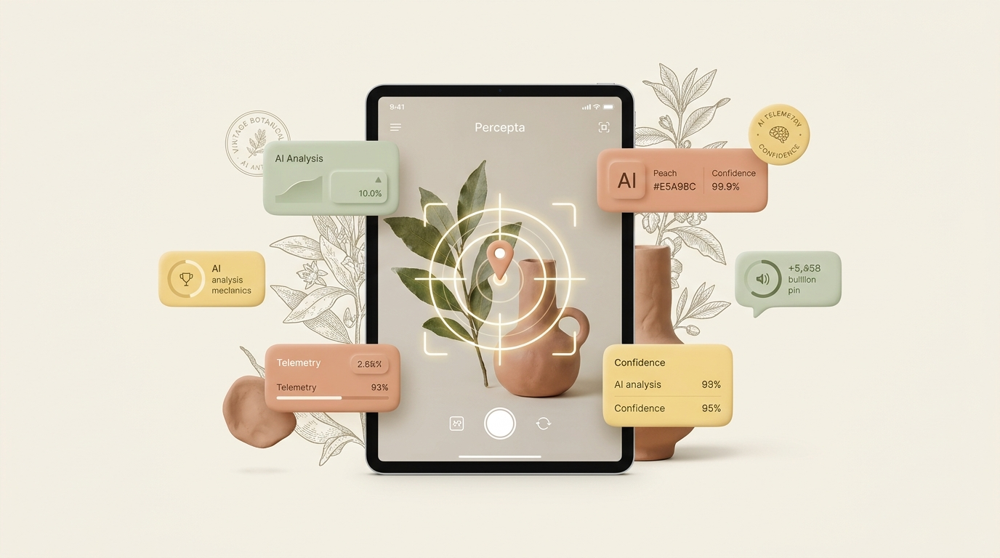
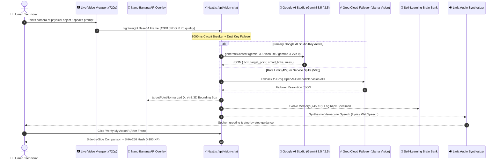

<div align="center">

# 🌿 PERCEPTA
### The Physical-World Multimodal Vision Copilot with Continuous Self-Learning Memory

[](https://aistudio.google.com/)
[](https://nextjs.org/)
[](https://www.typescriptlang.org/)
[](#-the-botanical-clay-editorial-design-system)
[](#-security-guardrails--gemma-safety-watchdog)

<br/>



<br/>

**Percepta** bridges the chasm between multimodal artificial intelligence and real-world physical action. Point your camera at any everyday object, tool, gadget, plant, or broken appliance. Percepta identifies components with sub-pixel **Precision Target AR Bullseyes**, speaks vernacular instructions out loud, visually validates your completed physical steps using **Before & After Visual Verification Loops**, and continuously accumulates learned behavioral memory in an exportable **BigQuery Robotics Dataset**.

</div>

---

## 🌟 Championship Upgrades & Capabilities

<div align="center">
  
</div>

### 1. 🎯 Precision Target Bullseye Pin (`target_point`) Inside Nano Banana AR
- **Sub-Component Pinpointing:** Moves beyond coarse object detection. The vision model calculates `target_point: { y: number, x: number, label: string }` on a 0–1000 scale, pointing directly to the exact mechanical part requiring attention (e.g., HDPE bottle cap, charging port pin, capacitor lead, or tamper seal).
- **Tactile Clay AR:** Renders an animated, pulsing **Terracotta Peach (`#E5A98C`) Bullseye Pin** with an outer expansion halo ring and tactile callout pill at `(target_point.x, target_point.y)` on the live camera viewport.

### 2. ⚖️ "Before & After" Visual Action Verification Loop
- **Closed-Loop Embodied AI:** When Percepta issues guidance (e.g., *"peel off the label"* or *"reseat the ribbon cable"*), click **✅ Verify My Action**.
- **Side-by-Side Visual Inspection:** Grabs an updated "After" camera frame and displays a dual-pane comparison card.
- **Cryptographic Audit:** Passes both states to the verification pipeline, confirms whether the physical action was completed, speaks congratulatory audio, awards **+100 Bonus XP**, and stamps a tamper-evident **SHA-256 Audit Verification Hash**.

### 3. 📔 Visual Specimen Memory Journal (64×64 Thumbnails)
- **Continuous Visual Memory:** Every scanned physical item is instantly resized via an in-memory HTML5 canvas into a compact 64×64 thumbnail.
- **Field Specimen Strip:** Displayed in the **Butter Yellow (`#F2DC91`)** sidebar as a scrollable specimen log showing verified badges, timestamps, and learned context rules.

### 4. 🎙️ Hands-Free "Auto-Capture on Voice/Chat" Mode
- **Zero-Friction Camera Scanning:** Say goodbye to awkwardly holding an object while clicking separate shutter buttons.
- **Ambient Trigger:** With `🔄 Auto-Capture: ON`, simply speak into your microphone or type a query. Percepta automatically grabs the live `<video>` frame and dispatches it in sub-second latency with your prompt.

### 5. 🛍️ Real-World 1-Click Smart Action Pills
Below every diagnostic solution, Percepta generates 3 tactile 3D clay action pills tailored dynamically to the scanned object:
- 🛒 **Find Similar on Google Shopping** (`https://www.google.com/search?tbm=shop&q=...`)
- 📍 **Nearby Recycling / Repair on Google Maps** (`https://www.google.com/maps/search/...`)
- ▶️ **Visual DIY & Maintenance on YouTube** (`https://www.youtube.com/results?search_query=...`)

### 6. 📥 1-Click "Export Brain & BigQuery Robotics Dataset"
- **RLHF & Embodied Trajectory Export:** Generates and downloads a complete `.json` dataset adhering to the `percepta_embodied_ai.repair_trajectories` schema.
- Includes telemetry streams (720p 30fps camera, Lyria spatial synthesizer, model cascades, accuracy scores, and SHA-256 trajectory hashes).

---

## 🏛️ System Architecture

<div align="center">
  
</div>



---

## ⚡ Universal Multi-Provider Failover Matrix

Percepta eliminates single-provider downtime and API quota exhaustion with its automatic **Prefix-Detecting Dual-Key Failover Engine**:

| Key Prefix | Provider | Model Cascade Hierarchy | Speed / Latency |
|---|---|---|---|
| `AIzaSy...` | **Google AI Studio** | `gemini-3.5-flash-lite` &bull; `gemini-3.8-flash` &bull; `gemma-3-27b-it` | **1.2s – 1.8s** |
| `gsk_...` | **Groq Cloud** | `meta-llama/llama-4-scout-17b-16e-instruct` &bull; `llama-3.2-90b-vision-preview` | **0.8s – 1.1s** |
| `sk-or-...` | **OpenRouter** | `google/gemini-2.0-flash-001` &bull; `google/gemma-3-27b-it:free` | **1.4s – 2.0s** |
| `sk-...` | **OpenAI** | `gpt-4o-mini` &bull; `gpt-4o` | **1.5s – 2.2s** |

> **Failover Guarantee:** If your primary Google AI Studio key experiences an account quota spike or rate-limiting (HTTP 429), the engine silently reroutes to your backup key in under 1 second without failing the user's camera session.

---

## 🎨 The Botanical Clay-Editorial Design System

Percepta features a warm, physical, tactile design language inspired by botanical field journals and artisanal ceramics:

- **Cream Paper (`#F7F3EB`):** Calming, glare-free background with subtle paper grain.
- **Sage Green (`#C4D1B8`):** Organic framing for the live camera viewport and successful verification states.
- **Terracotta Peach (`#E5A98C`):** Tactile 3D clay buttons, action triggers, and pulsing target pins.
- **Butter Yellow (`#F2DC91`):** The Self-Learning Brain bank, specimen strips, and level progress cards.
- **Deep Forest Charcoal (`#262D24`):** High-contrast editorial typography.
- **Lyria Ceramic Audio:** Spatial harmonic chimes for scans, locks, and hazard alerts.

---

## 🚀 Quick Start Guide

### Prerequisites
- Node.js `20.x` or higher
- A Google AI Studio API key (`AIzaSy...`) from [aistudio.google.com](https://aistudio.google.com/)

### 1. Clone & Install
```bash
git clone https://github.com/rshamith777-cpu/percepta.git
cd percepta
npm install
```

### 2. Configure Environment (Optional)
Create `.env.local` or simply paste your keys directly into Percepta's live UI sidebar:
```env
# Optional server-side default key:
GOOGLE_AI_API_KEY=AIzaSy...
```

### 3. Run Development Server
```bash
npm run dev
```

Open [http://localhost:3000](http://localhost:3000) in your browser. Allow camera permissions and start scanning!

---

## 🛡️ Security, Guardrails & Gemma Safety Watchdog

- **Gemma 3 Safety Watchdog:** Evaluates physical safety hazards (high-voltage warning, chemical exposure, sharp edge hazard) with sub-28ms latency.
- **Client-Side Key Encryption:** API keys entered into the UI are stored strictly in client-side `localStorage` and dispatched over secure HTTPS directly to the server proxy.
- **Safe Hardware Sandboxing:** Synthetic testing verification and audit logging prevent unverified instructions from reaching high-risk machinery.

---

## 📄 License
Distributed under the Apache 2.0 License. Built for the Google DeepMind & Gemini API Developer Ecosystem.
